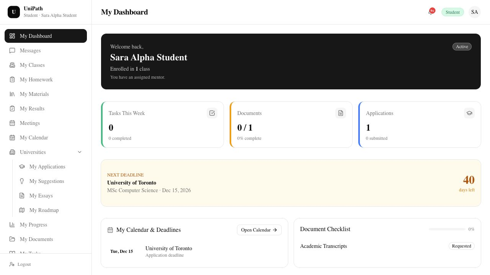
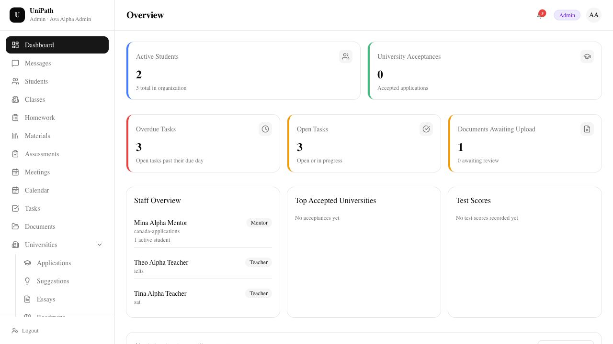
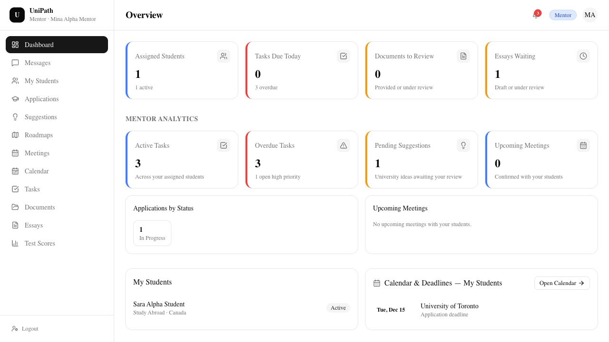
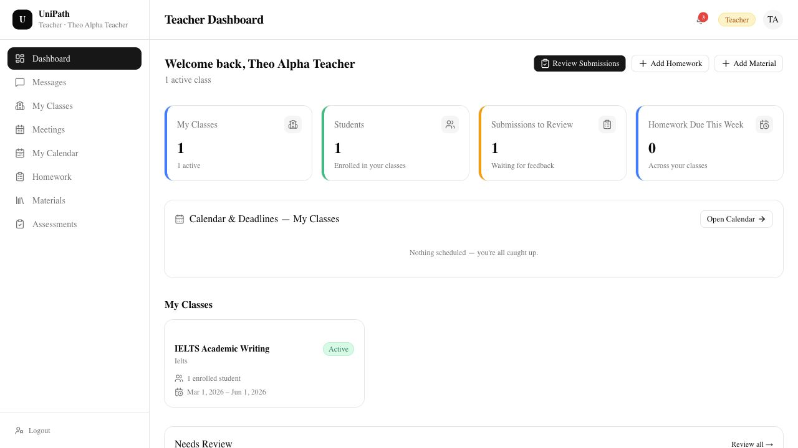
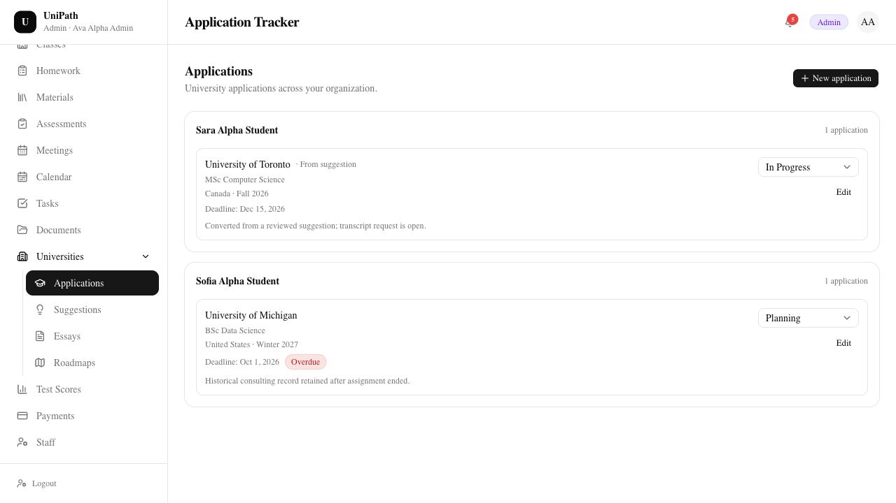
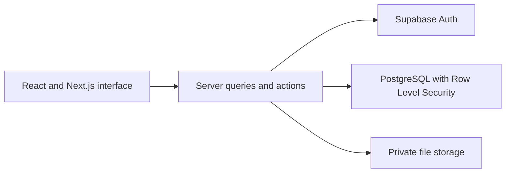

# UniPath

**One workspace for an education agency's administration, mentoring, teaching and student workflows.**

Next.js / TypeScript / React / PostgreSQL / Supabase / Tailwind CSS

**Pre-launch / Co-founder & Full-Stack Engineer / Built collaboratively**

This repository presents the product and selected engineering decisions. The application source remains private.

*A student's view of their class, applications, document checklist and next deadline. Screenshots show the working local application with fictional records.*

## The problem

Education agencies need to coordinate student applications, document requests, teaching activities and deadlines. Those workflows involve different responsibilities: an administrator needs an organization-wide view, a mentor needs assigned students, a teacher needs their classes, and a student needs their own records.

UniPath brings those workflows into one application while enforcing those differences in access.

## Product walkthrough

| Role | Examples of implemented workflows |
| --- | --- |
| Admin | Organization dashboard, student and staff records, applications, document review and internal payment tracking |
| Mentor | Assigned students, applications, essays, tasks, roadmap files and score review |
| Teacher | Own classes, enrolled students, homework, materials and assessments |
| Student | Own applications, documents, homework, scores, roadmap and meeting booking |

Other implemented features include role-scoped messaging, in-app notifications, calendar views and meeting management. Payment tracking is an internal ledger, not payment processing or subscription billing.

## Screenshots

<strong>Admin: organization dashboard</strong>

Organization-level student counts, tasks, document queues and staff assignments.

<strong>Mentor: assigned students and consulting work</strong>

The mentor workspace summarizes tasks, application status and deadlines for actively assigned students.

<strong>Teacher: classes and teaching activities</strong>

The teacher sees their own classes, enrolled students and submissions awaiting review.

<strong>Applications: student-specific records and deadlines</strong>

Applications are grouped by student, with program details, status and deadlines.

All names and records in these screenshots are fictional. [Walkthrough and capture notes](docs/walkthrough.md).

## Architecture

This is a simplified view of the application boundaries. Normal dashboard reads use the signed-in user's request-scoped client; PostgreSQL policies determine which records that user can access. Privileged operations remain server-side and require their own authorization checks.

[Explore the conceptual data model and integrity rules](docs/data-model.md).

## Engineering decisions

### Complete dashboard totals under API row limits

**Problem:** A successful API response can contain only part of a dataset. Counting that response can silently understate the number of students, tasks or applications.

**Implementation:** Dashboard table reads use keyset pagination until an empty page. Counts and summaries are derived from the complete authorized result. If a required read fails, the affected section shows an error instead of a partial total or a misleading zero.

**Validation:** Integration tests compare dashboard results with independent SQL reads and exercise smaller response caps and failures during retrieval.

### Access rules follow organization and assignment boundaries

An administrator's access is limited to their organization. Mentor access depends on active student assignments; teacher access depends on classes and enrollment; students see their own permitted records. These rules are enforced at the database boundary, alongside application checks.

Automated database and integration tests exercise cross-organization access, role permissions and changes to assignment-based access.

### Data rules belong in the database too

The relational model includes organizations, accounts, student and staff profiles, classes, enrollments, mentor assignments and consulting workflows. Foreign keys, uniqueness constraints and validation triggers enforce relationships and business rules. For example, a student cannot have conflicting active mentor assignments, and related records must belong to the same organization.

Exam scores use typed fields and scale-specific validation. Dashboards group score histories by exam rather than presenting unsupported comparisons across different scales.

## Testing approach

- Database tests for constraints, permissions and Row Level Security.
- Integration tests for authorized reads, mutations, file workflows and query completeness.
- TypeScript tests for validation, mapping and business rules.
- Browser checks recorded for specific implemented flows; no blanket claim of support for every browser or device.

Development checks use fictional fixtures. The project is preparing for beta use; the examples here demonstrate implemented behavior rather than real student outcomes.

## My role

I am a co-founder and full-stack engineer, working with a teammate on the product. My work spans database modeling, dashboard integration, application workflows, access controls and validation.

## Source availability

The implementation repository remains private. This separate repository presents selected product behavior, architecture and engineering decisions without publishing the application's source or development history.

## Contact

[Amin Behbudov on GitHub](https://github.com/aminbhv) / [LinkedIn](https://www.linkedin.com/in/amin-behbudov-a79531370)
