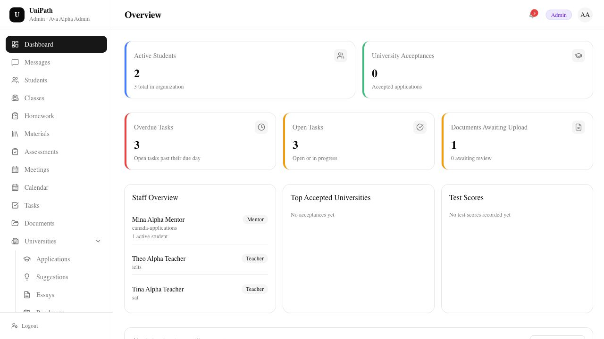
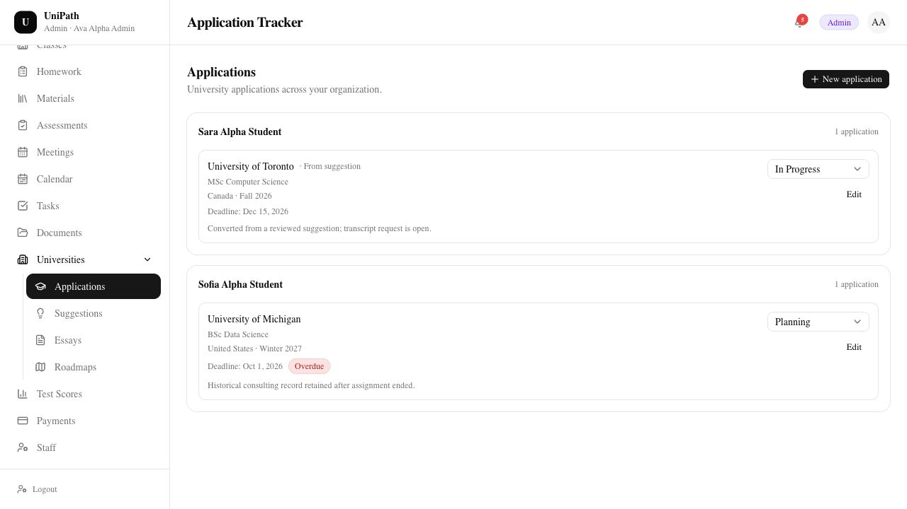
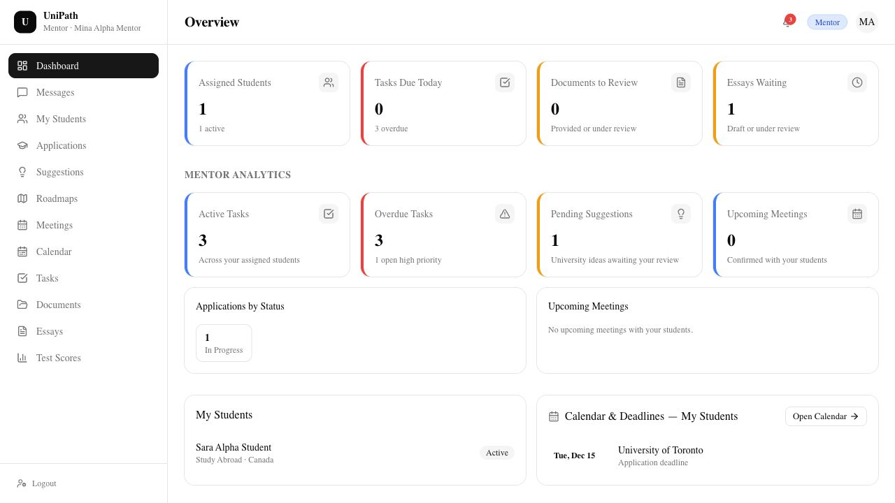
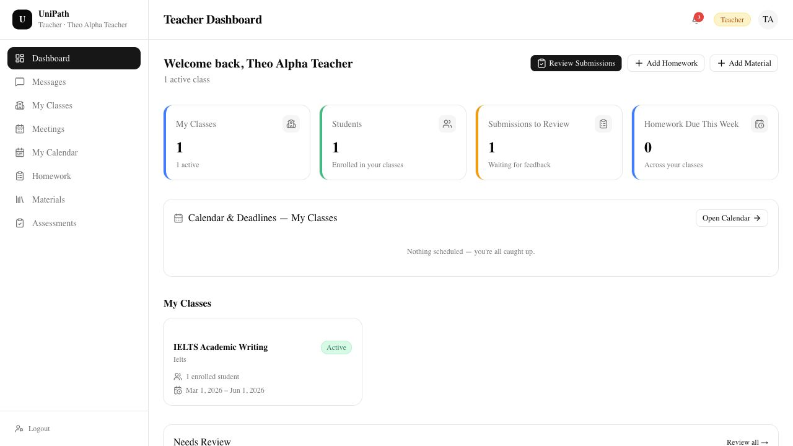
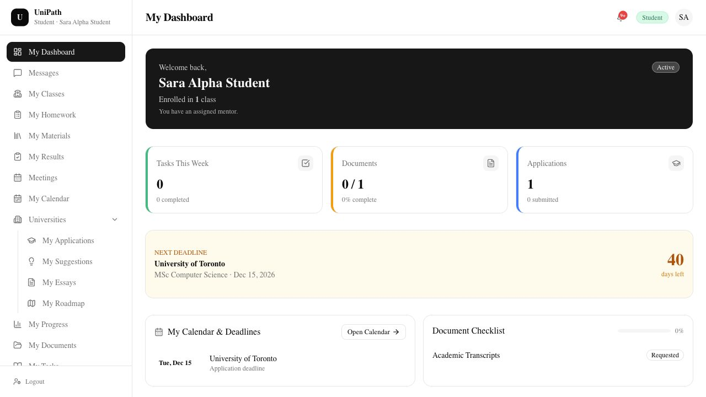

# Product walkthrough

The screenshots were captured on November 5, 2026 from the working local application using existing fictional demonstration records. They are application screenshots, not design mockups. The gallery covers selected screens, not every feature of the platform.

## 1. Start with the agency view

The administrator has an organization-level view of active students, application acceptances, open and overdue tasks, document requests and staff assignments. Empty sections reflect the demo records available at capture time.

## 2. Review an application

The application tracker groups applications by student. A record contains its university and program, destination, intake, deadline and current status. The administrator can see the organization's current and retained historical consulting records.

## 3. Narrow to a mentor's responsibilities

The mentor dashboard shows an assigned student and the work associated with that active assignment: tasks, application status, essays and deadlines. This narrower workspace reflects the mentor's permissions rather than a client-side role toggle.

## 4. Switch to teaching

The teacher workspace summarizes the teacher's classes, enrolled students, homework and submissions. Consulting and agency-wide management controls are outside this role's workspace.

## 5. Finish with the student

The student sees their own class, document checklist, applications and next deadline. The navigation and available data differ from those of the administrator, mentor and teacher.

## Capture scope

- Each workspace was opened through its own fictional role account.
- The screenshot session navigated existing records; no student, application, score or class records were created or edited for the gallery.
- Demonstration counts, names and dates are illustrative. They are not claims about real users, adoption or student outcomes.
- The gallery does not provide public access to the application or its private source repository.
